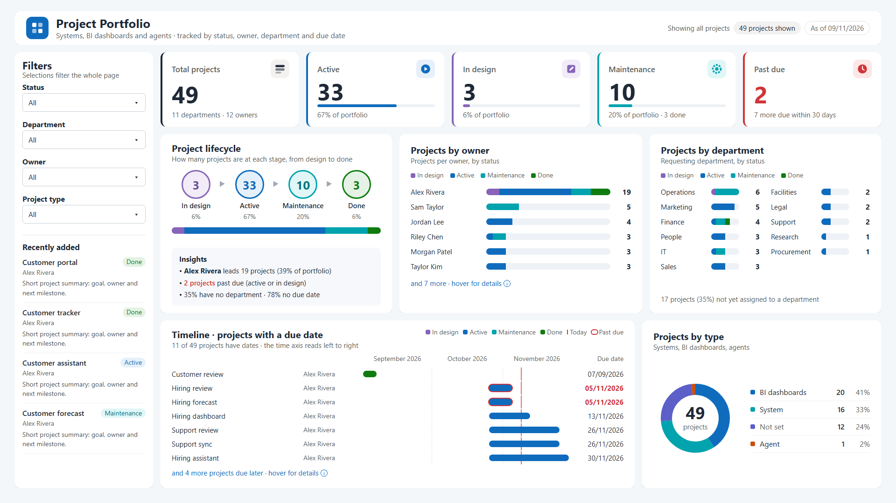

<div align="center">

# PBI HTML Content Agent

**An AI agent kit that builds pixel-exact Power BI dashboards on the HTML Content visual - left-to-right or right-to-left - written straight into PBIP/PBIR, checked automatically, versioned like code.**

[](LICENSE)




<sub>English / left-to-right build, palette <code>ocean</code>, rendered by the kit's exact-size preview (headless Edge) from measures evaluated on a live Power BI model; all names, projects and departments are invented sample data. The same measures build the Hebrew right-to-left version with one setting.</sub>

</div>

---

## Why this exists

Native Power BI visuals cannot draw a lifecycle tracker, a segmented status bar per owner or a milestone strip, and the built-in Card cannot hold an in-card sparkline or progress strip - the HTML Content visual can, but only if every card fits its frame, every Hebrew sentence runs right-to-left, and every color stays readable. Getting that right by hand is slow and fragile. This kit makes it repeatable:

| Problem we hit in Desktop | What the kit does about it |
| --- | --- |
| Cards clipped at the bottom, titles wrapping | Reads the theme's padding and writes **padding 0** on every visual; an **exact-size fit check** with 8px slack gates every build |
| Hebrew titles left-aligned despite `dir="rtl"` | Direction-aware inline `direction` + `text-align` on every card root |
| 12px text unreadable after Fit-to-page | A central **type scale** for 1920×1080 |
| Colors that fail contrast on soft fills | **Palette tokens** with separate text-safe colors, and a **WCAG contrast gate** |
| "Looks fine" until a filter empties a list | **Stress scenarios** re-render every card under several filter states, including an empty selection |
| A change that breaks something unnoticed | A **byte-level regression gate** + **versions with revert**, committed and tagged in git |

## Features

- **Composite or fullscreen dashboards** of HTML Content visuals at exact coordinates, mixed with native slicers and buttons.
- **A component library** (`library/components/`) - bullet, IBCS variance, dumbbell, lollipop, waffle, calendar heatmap, milestone timeline, org strip, KPI cards and more - each a paste-ready DAX measure.
- **Real interactivity** - cards respond to every slicer and filter; row-bound cards cross-filter other visuals through the Context role; page navigation through native buttons layered over the HTML.
- **Theme-aware** - colors from palette tokens or the report theme (`--pbi-theme-*` CSS variables), PBIR GUIDs for both editions (Regular and Secure).
- **Left-to-right and right-to-left** - one setting (`DASH_DIR=ltr|rtl`) flips the whole layout (filter panel, reading order, alignment, arrows); RTL gets bidi isolation of numbers, currency and dates.
- **UI language** - display strings are translated by `DASH_LANG` (`he` authored, `en` included) while data values and model names are protected, so filters never break; a build fails if any string is left untranslated.
- **Palettes** - `ocean` (light), `midnight` (dark), `berry` and `vivid` (colorful: gradient page + filled KPI cards). Switch with one variable; every palette passes the fit and contrast gates.
- **Direct PBIR authoring** - TMDL measures and `visual.json` files written by script; Desktop picks them up with *Apply external changes*.
- **Honest by design** - no fake buttons, no promises the Secure sandbox cannot keep, and every claim labeled as measured or doc-based.

## What the agent will not do (and will not pretend to do)

- Build "HTML buttons" that look clickable but do nothing. Page navigation happens only through native Power BI buttons or a real cross-filter.
- Promise that scripts work in the Secure (certified) edition - its sanitizer removes them.
- Use localStorage, cookies, pop-up windows or external scripts - the Power BI sandbox blocks them in every edition.
- Present anything as "tested" unless it was run. Every component states what is doc-based and what still needs validation in Desktop.

## Quick start

1. Copy this folder next to your PBIP (or anywhere your agent can read it).
2. Tell your agent (Claude Code, Cursor, ...) to read `AGENTS.md` first (it points to the design system and the build workflow).
3. Ask in plain language: *"Build an RTL portfolio dashboard on table X with a KPI row, a right filter panel and a timeline."*

To drive the pipeline yourself, copy `tools/pbip-html-pipeline/` next to the PBIP as `_build/`, then **adapt it to your model first**: copy `pipeline.example.json` to `pipeline.json` and fill in your PBIP name, host table, page and backup folder, then write your measures and `LAYOUT` in `measures.py` (start from `measures_example_projects.py`, the reference build). Make a backup copy of the PBIP, open it in Power BI Desktop, and take a baseline once with `python -I versions.py snapshot "baseline" --results r_all.json` after the first run of steps 1-2. Then run the loop:

```bash
python -I gen_query.py q_all.dax                                     # define + evaluate every HTML measure
powershell -File runq.ps1 -QueryFile q_all.dax -OutFile r_all.json   # run it on the open Desktop model
python -I regress.py r_all.json                                      # only intended cards changed?
python -I gen_preview.py r_all.json preview.html                     # exact-size preview
node fitcheck.mjs preview.html --shot full.png                       # GATE: FIT OK + CONTRAST OK
python -I stress.py                                                  # GATE: filter scenarios (all, one status, one owner, blanks, empty, every column filtered)
python -I versions.py snapshot "what changed" --fit "FIT OK" --results r_all.json --shot full.png
python -I gen_pbip.py                                                # write TMDL + visual.json
```

Then in Desktop: **Apply external changes → Home ▸ Refresh**. Requirements: **Windows** with Power BI Desktop (PBIP enabled; `runq.ps1` uses Windows PowerShell and Desktop's own AdomdClient), Python 3, Node 22+ and Microsoft Edge (found in the default install paths, or set `EDGE_PATH`) - no npm or pip packages. Details: [`tools/pbip-html-pipeline/README.md`](tools/pbip-html-pipeline/README.md).

## Repository map

| Path | What is there |
| --- | --- |
| [`AGENTS.md`](AGENTS.md) | The agent's brief, starting with the **fit-to-canvas contract** |
| [`reference/design-system.md`](reference/design-system.md) | Measured rules: card frame, fit budget, type scale, color and contrast, lists, direction and language |
| [`reference/build-workflow.md`](reference/build-workflow.md) | Iterating safely in Desktop, testing, versions, git |
| [`ROADMAP.md`](ROADMAP.md) | 20-step plan: what is built and measured, what is researched next |
| [`tools/pbip-html-pipeline/`](tools/pbip-html-pipeline/) | Build · gate · version · write pipeline |
| [`library/`](library/) | Components (`.dax`), palettes, icons (Kubai, MIT), fullscreen shell |
| [`skills/`](skills/) | dashboard-shell, composite-dashboard, html-slicers-filters, navigation-header-menu, rtl-hebrew |
| [`reference/`](reference/) | Verified PBIR / HTML Content properties, capabilities, canvas and layout |
| [`examples/`](examples/) | Worked examples (sales dashboard, context interaction, KPI with icon) |
| [`checklists/validation.md`](checklists/validation.md) | What to check in Desktop, Service, mobile and export |
| [`research/`](research/) · [`SOURCES.md`](SOURCES.md) | Demand research and dated sources for every factual claim |

## What is in the component library (`library/components/`)

Each component is one `.dax` file: a ready-to-paste measure + a CSS block for the Stylesheet property + binding and sizing notes. All of them are RTL-clean (numbers, currency and dates are isolated correctly), and all work in both editions unless stated otherwise.

The library has three layers. Its core is the differentiation layer: components that give value the built-in visuals do not. What to build was decided from documented demand research (what users actually ask for on reddit, Microsoft Ideas and AppSource downloads - see `research/user-demand.md`), and every "no built-in equivalent" claim was checked against the specific feature page on Microsoft Learn (not only the catalog list) on 9 Nov 2026 and classified honestly: no built-in / built-in workaround exists / built-in exists and HTML adds composition - see `SOURCES.md`.

### Differentiation layer - the value HTML adds beyond the built-ins

Every "no built-in" claim here was checked against the official feature page on Microsoft Learn on 9 Nov 2026 (links in `SOURCES.md`) and is classified in one of three ways: **no built-in at all**, **built-in workaround exists** (works, but not in this form), or **built-in exists and HTML adds composition**.

| Component | What it gives | Status versus the built-ins |
| --- | --- | --- |
| `insight-narrative` | An insight sentence computed entirely in DAX: values, colored up/down tokens and a sparkline inside the sentence | **Built-in exists**: the Narrative visual (smart narrative, custom mode) writes text with dynamic values - without a chart inside the sentence, without styled tokens and without precise bidi isolation |
| `exception-cards` | An operational exception queue: only categories below target are drawn (empty rows drop out), each row with gap, severity and a recommended action | **No built-in**: a table with conditional formatting gives data, not a designed action queue |
| `stage-tracker` | A sequence of connected process stages: status per stage, a counter, and conversion % on the connectors | **No built-in**: Funnel shows falling values as bars, not a status flow with conversions |
| `variance-columns` | A filled actual column + an outlined plan column + a green/red variance bridge + signed % (IBCS) | **No built-in**; the common commercial solution (Zebra BI) is paid |
| `bullet-chart` | Actual versus target on quality bands (65/85/100%) with a target marker | **No built-in**; [SQLBI](https://www.sqlbi.com/articles/building-bullet-charts-in-power-bi-reports/): assembled "MacGyver" style from columns. AppSource: OKVIZ, xViz |
| `dumbbell-chart` | Two periods as connected dots + a signed delta per category | **No built-in**; AppSource: MAQ and others |
| `lollipop-chart` | A stem + a value dot in a status color versus target; lighter than columns | **No built-in** |
| `waffle-chart` | A 10×10 grid where each cell is one percent of the target | **No built-in**; AppSource: Waffle Chart and others |
| `calendar-heatmap` | A GitHub-style daily density floor for a year, 365 Context rows | **Built-in workaround exists**: a matrix with background conditional formatting gives a heat grid, not GitHub's week-columns shape; AppSource: OKVIZ ProCalendar |
| `kpi-trend` | A rich KPI card: value + sparkline + YoY pill + target-attainment pill + status edge | **Partly built-in**: the modern Card gives value + reference labels + images, but no sparkline inside the card (built-in sparklines exist only in table/matrix) |
| `scorecard-table` | A metric row with a wide sparkline + value + completion pill + status dot | **Built-in exists**: sparklines in table/matrix exist (in preview); here the full composition is one row with exact styling |
| `alert-banner` | A conditional exceptions banner: how many categories are below target, and which | **Complements built-in**: data alerts exist (Service, and Activator in preview) but they are notifications; there is no designed in-canvas banner |
| `filter-banner` | The active filter state as styled chips inside the canvas itself | **Built-in workaround exists**: a Card with a dynamic text measure prints the state as plain text; the filter pane is outside the canvas |
| `radial-progress` | A thin progress ring with the KPI in the center | **Built-in workaround exists**: the Gauge is a dial with a needle, and a donut coerced into a ring - not a thin ring with designed center content |
| `milestone-timeline` | A flat timeline: milestone markers alternating above/below the axis, with name + date, status color (done/current/planned) | **No built-in**: the built-in Gantt (preview) is a task scheduler with durations - not a light milestone strip; direct demand on reddit (2022, 2023). Documented limit: a single axis; milestones that are too dense collide |
| `org-strip` | A fixed hierarchy chart: root + up to 6 subordinate cards with connectors, all positioned by DAX | **No built-in**: [an official Microsoft Epic idea](https://community.fabric.microsoft.com/t5/Fabric-Ideas/Epic-idea-Organization-chart/idi-p/4520633) (10/2024) with user requests. Documented limit: exactly two levels, no expand/collapse and no dynamic depth |

### Skeleton layer

`header-bar` · `side-menu` · `slicer-chips` · and a full shell in `library/shell/`

Paste instructions for each component are at the top of its file, including its layer and rationale. Full color palettes are in `library/palettes.md`.

## Interactivity: what each component can do (verified against the official docs, 9 Nov 2026)

Source: https://html-content.com/docs/interactivity. The rule: Power BI resolves a clicked element to a data row only if the visual is built with rows in the Context role. A complete practical example (including a manual tooltip, hover, unselected, `data-hc-suppress`): `examples/context-interaction.dax`.

| Class | Components | What works |
| --- | --- | --- |
| **Row-bound (Context), 12 components** - a click filters other visuals, contextual tooltip, right-click drillthrough | bar-chart-svg, bullet-chart, calendar-heatmap, data-table, data-table-databars, donut-legend, dumbbell-chart, exception-cards, lollipop-chart, scorecard-table, slicer-chips, variance-columns | Everything - after turning on Cross-filtering > Enable in the format pane |
| **Optional Context, 4 components** - a single measure by default; adding a column to Context makes it per-row | badge-status, donut-svg, progress-bar, kpi-card | Without Context: display only. With Context: like row-bound |
| **Single aggregated measure, 16 components** - no row resolution; manual tooltip possible (`tooltipEnabled` + `data-tooltip-*`) | alert-banner, filter-banner, gauge-svg, header-bar, insight-narrative, kpi-card-icon, kpi-card-sparkline, kpi-trend, line-chart-area, line-chart-svg, milestone-timeline, org-strip, radial-progress, side-menu, stage-tracker, waffle-chart | Manual tooltip only; no cross-filter |

Hard limits (every edition): no writeback to the model, no triggering export, no live hover sync between two separate visuals, no control over other slicers. Page navigation = native buttons over the HTML only.

**Custom icons (Kubai, MIT):** `library/icons/` - 12 static SVGs for inline embedding in KPI cards and the side menu, with embedding instructions and license. Example: `examples/kpi-with-icon.dax`.

## Visual editions (important before you start)

The HTML Content visual (by Daniel Marsh-Patrick, free and open source) ships as two separate editions on AppSource:

- **HTML Content (Regular)** - the most flexible: all the HTML/CSS/SVG the sandbox allows, external images, and from version 2.0 also `<script>` execution and inline event handlers. Uncertified, so it is not included in export to PDF/PowerPoint or in email subscriptions.
- **HTML Content Secure 🛡️** (formerly HTML Content (lite)) - certified by Microsoft: sanitized, no external resources, no scripts. Suitable for organizations restricted to certified visuals, and included in export.

Every library component is marked with the edition it suits. The agent's default is Secure, unless the need requires Regular (for example scripts or external content).

## Verification status (honesty label)

- **Measured in Power BI Desktop (Oct 2026 release, 9 Nov 2026):** the fit-to-canvas contract, the pipeline (`tools/pbip-html-pipeline/`) and the rules in `reference/design-system.md` and `reference/build-workflow.md`, on a real 1920×1080 Hebrew RTL dashboard with the Secure edition - including padding 0, RTL alignment, the type scale, palette-driven slicers, the gradient background layer and filled KPI cards.
- **Documentation-based, not yet run in Desktop:** the components in `library/components/` and the example in `examples/` (written from the HTML Content 2.0 docs, the PBIR Implementation Guide and Microsoft Learn, 9 Nov 2026), and the items marked 📋 in `ROADMAP.md`. Before production use, run `checklists/validation.md`. Every component that needs checking is marked `not run in Power BI`.

## Contributing

Work happens through pull requests: one branch per change, a code review on the PR, merge through the PR - never directly to `main`. Every dashboard change must pass `regress.py`, `fitcheck.mjs` and `stress.py`, and a rule measured in Desktop that holds for everyone is added to the reference document it belongs to, with its reason and how to verify it. Never commit keys, env files, pulled data or `.pbi` caches (see `.gitignore` and `reference/build-workflow.md`).

## License

[MIT](LICENSE) © 2026 Reuven Kazorer.

Third-party: the **HTML Content** custom visual is a separate free, open-source project by Daniel Marsh-Patrick ([html-content.com](https://html-content.com), MIT) and is not included here. Icons in `library/icons/` are from Kubai Icons (MIT, see `library/icons/LICENSE-MIT-kubai`). Power BI is a trademark of Microsoft.
